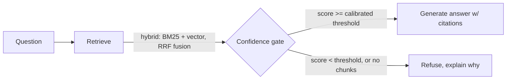

# Production-Grade RAG — Kubernetes API Documentation

A retrieval-augmented question-answering system over Kubernetes API
documentation **across six versions (1.19 → 1.31)**, built to cite its
sources or refuse to answer rather than hallucinate — and built the way a
production system should be: every architectural choice backed by a
measured before/after delta, not a tutorial's assumption, with the losing
experiments kept and written up, not deleted.

**Why this domain is a real test, not a demo prop.** Kubernetes docs have
genuine, well-documented breaking changes between versions — API group
promotions (`extensions/v1beta1` → `networking.k8s.io/v1`), resources
removed outright (`PodSecurityPolicy`), semantic changes hiding behind an
unchanged field name. A version-unaware answer here doesn't just read
badly — it's the kind of confident, outdated advice that breaks someone's
cluster in production. Citations and calibrated refusal aren't decoration
in this domain; they're the actual product requirement.

**Live demo:** not yet deployed — see [Status](#status) below for exactly
what "not yet" means and what it would take.

## Results

| Metric | Baseline (Phase 1) | Shipped (Phase 4) |
| --- | --- | --- |
| Retrieval Recall@8 | 100.0% | 100.0% |
| MRR | 0.881 | 0.893 |
| Refusal recall (should-refuse questions caught) | 16.7% | **83.3%**, 0 false refusals |
| p50 latency | 7 ms | 76 ms |

The headline number is refusal recall: a naive pipeline with no confidence
gating answered confidently on 5 of 6 questions it should have declined —
exactly the failure mode that makes an unguarded RAG system dangerous to
trust. A refusal threshold calibrated empirically against the retriever's
own confidence score (`scripts/calibrate_refusal.py`, Youden's J over the
golden set) closes most of that gap, at zero cost to the questions the
system *should* answer. Full numbers, every phase, every metric: `docs/ABLATIONS.md`.

**Cost and practicality:** every number above was produced by network-free
local components, so it's real but it's also $0.00. `docs/ABLATIONS.md`'s
["Cost & practicality"](docs/ABLATIONS.md#cost--practicality--the-comparison-across-everything-tried)
section prices out what the recommended production stack (real embeddings
+ real LLM + reranker) would actually cost using this project's own
measured token usage and current published API pricing (~$0.0015/query,
under $500/month at 10K queries/day) -- and gives the direct, six-point
verdict on what's actually blocking production use, which isn't cost.

## Architecture



Orchestrated as an explicit [LangGraph](https://github.com/langchain-ai/langgraph)
state graph (`src/k8s_rag/graph.py`) — the pipeline has real branching
state (refuse vs. generate), which is what LangGraph is for. Traced
end-to-end with [LangSmith](https://smith.langchain.com/) when
`LANGCHAIN_API_KEY` is set; every request is also traceable without it —
`src/k8s_rag/api.py`'s structured logs carry a `request_id`, the retrieved
chunk ids/scores, and the exact git commit + config that produced the
answer (Phase 6/8).

This diagram is deliberately not the diagram from the original roadmap —
that one had a `reranker` box between fusion and the confidence gate. It
doesn't exist: a real ML cross-encoder reranker needs a model this
project's dev sandbox couldn't reach (huggingface.co blocked; confirmed,
not assumed — see `docs/ABLATIONS.md` Phase 4). The diagram reflects the
pipeline that actually runs, not the one that was planned.

## Rejected tradeoffs

Every one of these was built, measured, and kept in the repo alongside the
technique that won — not silently reverted. Full root-cause writeups in
`docs/ABLATIONS.md`.

| Rejected | In favor of | Why (one line) |
| --- | --- | --- |
| `recursive` (header-aware) chunking | `parent_document` chunking | More, smaller chunks diluted term density; recall dropped from 100% to 92.9% |
| `spacy_vectors` embeddings | `local_tfidf` | General-domain word vectors dilute jargon-heavy Kubernetes text; MRR dropped from 0.881 to 0.196 |
| Per-version query fan-out (Phase 5) | Single-query retrieval | Broke the calibrated confidence gate (RRF's rank-based score isn't comparable across differently-sized candidate pools) *and* a generic "deprecation-guide" page won ties within each version's own subset — refusal recall collapsed from 83.3% to 50% |
| Hybrid retrieval as an unqualified win | Hybrid, with the latency cost stated plainly | Real gain was marginal in this sandbox (both retrievers ended up lexical); real, measured ~9x latency cost from `rank_bm25`'s linear scan |

## Status

Built phase by phase, ongoing. See `docs/ABLATIONS.md` for the full
per-phase writeup (this is the single most important document in the
repo) and the [project roadmap](https://claude.ai/code/artifact/3b1ccaf6-89b2-4cb2-997b-4fbd4c050d5e)
for the plan each phase was measured against.

| Phase | Status |
| --- | --- |
| 0 — Corpus + golden eval set | **Done** — 57 real doc pages across 6 k8s versions, 20-question golden set |
| 1 — Naive baseline (vector-only) | **Done** |
| 2 — Chunking ablation | **Done** — `parent_document` wins (see Rejected tradeoffs) |
| 3 — Hybrid retrieval (BM25 + vector) | **Done** — RRF fusion; latency tradeoff stated plainly |
| 4 — Reranking + calibrated refusal | **Partially done** — confidence gate shipped (83.3% refusal recall); real ML reranker blocked (huggingface.co) |
| 5 — Query understanding | **Done — negative result, not shipped** (see Rejected tradeoffs) |
| 6 — Config & experiment infrastructure | **Done** — every run records its git commit + config hash; `scripts/list_experiments.py` catches drift |
| 7 — Eval-as-CI | **Done, with one caveat** — regression gate built and verified against a real regression; the GitHub Actions workflow itself was never run on a live runner (no route to github.com's Actions API from this sandbox) |
| 8 — Productionization (FastAPI, Docker, LangSmith) | **Done, with one caveat** — the API service was verified live with real HTTP requests; the Docker image was never actually built (this sandbox's Docker CLI has no daemon) |
| 9 — Ship (hosted demo, case-study README) | **README done. Hosted demo not deployed.** Deploying needs an external host (Render/Fly.io/Railway/Cloud Run) and credentials this session doesn't have — `Dockerfile` and `docker-compose.yml` are ready for whichever platform is chosen. |

## Quickstart

```bash
python -m venv .venv && source .venv/bin/activate
pip install -r requirements.txt

# Phase 0: build the corpus (pulls a handful of Kubernetes doc versions)
python scripts/fetch_corpus.py

# Phase 1: ingest into Chroma and ask a question
python scripts/ingest.py
python scripts/ask.py "What apiVersion should I use for Ingress in Kubernetes 1.31?" --version 1.31

# Run the eval suite against the golden set
python scripts/run_eval.py

# Unit tests
pytest tests/ -q

# Phase 8: serve it (POST /ask, /ask/stream, GET /health, GET /metrics)
python scripts/serve.py
curl -X POST localhost:8000/ask -H "Content-Type: application/json" \
  -d '{"question": "What apiVersion should I use for Ingress?", "target_version": "1.31"}'

# ...or in a container (Dockerfile/docker-compose.yml are written but not yet
# verified against a live Docker daemon from this project's dev sandbox --
# see docs/ABLATIONS.md Phase 8)
docker compose up
```

No API key is required to run the baseline end to end. By default
(`config/default.yaml`), embeddings use a local `sentence-transformers`
model and generation is a stubbed extractive answerer. On a normal machine
with regular internet access, just use the default config:
`python scripts/ingest.py` (no `K8S_RAG_CONFIG` needed).

This repo's own dev runs happened in a sandbox whose egress policy blocks
huggingface.co (and every LLM/embedding API host) at the organization
level — confirmed still blocked even after a network change on the
developer's end, since it's an allowlist, not a local setting. Two
network-free fallbacks are built in and both were actually run, with real,
different results (see `docs/ABLATIONS.md` for the full comparison — it's
worth reading, not just a footnote):

- `config/sandbox_local.yaml` — `embedding.provider: local_tfidf`, pure
  scikit-learn bag-of-words, zero network dependency. **This is the
  recorded Phase 1 baseline** — it outperformed the option below on this
  jargon-dense corpus.
- `config/sandbox_spacy.yaml` — `embedding.provider: spacy_vectors`, real
  static word vectors (`en_core_web_md`), installed from a GitHub release
  asset rather than huggingface.co (GitHub is reachable here even though HF
  isn't). Genuine semantic similarity, but it underperformed TF-IDF on this
  corpus specifically — see `docs/ABLATIONS.md` for why.

Set `OPENAI_API_KEY` and `generation.provider: openai` in config for real
generation quality and to unlock the Ragas faithfulness metrics in
`scripts/run_eval.py`. Set `LANGCHAIN_API_KEY` to get LangSmith tracing on
every run, for free, with no code changes.

## Repo layout

```
config/            # versioned run configs (chunking, retrieval, prompts, model)
data/corpus/       # fetched, chunked Kubernetes docs, one folder per version
data/eval/         # golden eval set (golden_qa.jsonl) + results/ (every recorded run)
src/k8s_rag/       # library code: ingestion, retrieval, fusion, graph, eval, API
scripts/           # thin CLI entry points that call into src/k8s_rag
docs/ABLATIONS.md  # the running ablation results table -- read this first
tests/             # unit tests for retrieval components + the API (58 passing)
Dockerfile, docker-compose.yml, docker-entrypoint.sh   # Phase 8 (see caveat above)
.github/workflows/eval-ci.yml                          # Phase 7 (see caveat above)
```

## Why these design decisions

See `docs/ABLATIONS.md` for the numbers behind every choice on this page,
and the [project roadmap](https://claude.ai/code/artifact/3b1ccaf6-89b2-4cb2-997b-4fbd4c050d5e)
for the reasoning behind each phase before it was measured.
